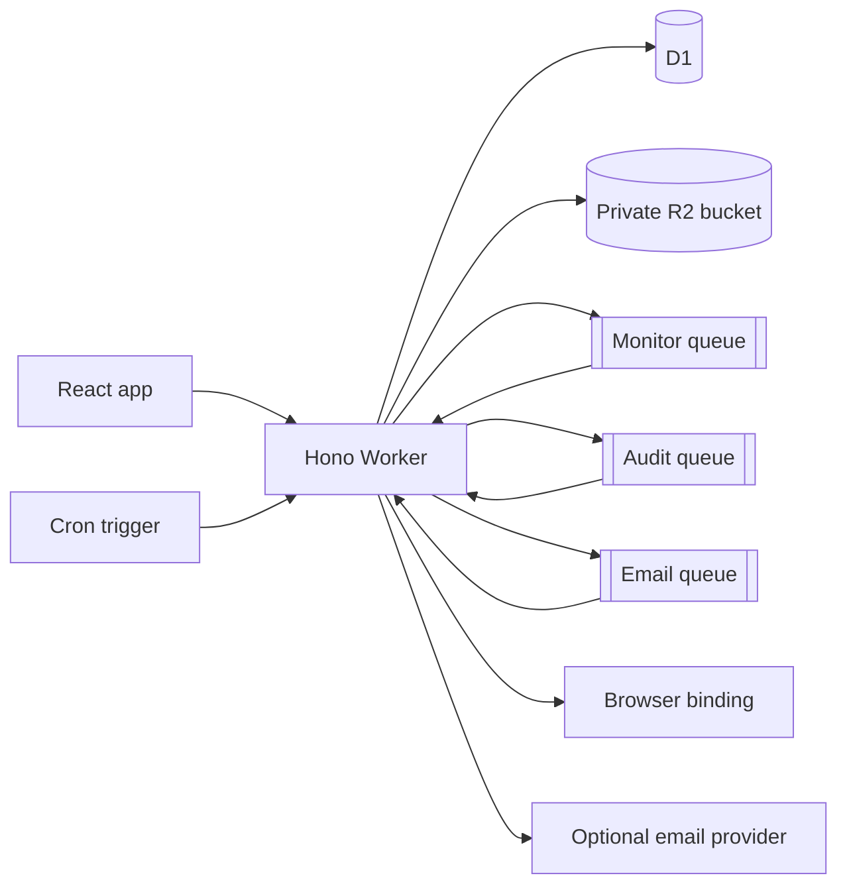

# Architecture

Zenith Community runs as a Cloudflare Worker with a React application served through the Assets binding. The Worker handles authentication and JSON APIs. D1 stores account, site, monitoring, audit, and notification data; R2 stores private report assets; Queues run monitoring, audit, and email jobs.

## Request and job flow

- The Worker loads typed configuration, adds security headers, enforces same-origin checks for mutations, and resolves Better Auth sessions.
- Monitoring cron work finds due enabled monitors, advances their next-check time, then enqueues bounded HTTP checks.
- Audit requests enqueue a bounded crawler job. HTTP rules and best-effort browser checks produce findings and a deterministic score, which are stored in D1.
- Queue delivery is at least once. Email jobs use expiring D1 leases to recover interrupted work; Resend receives an idempotency key, while Cloudflare Email may rarely send a duplicate if a worker stops after provider acceptance but before recording completion.
- Public status pages expose uptime and incident information only. Audit findings and account details remain private.

## Data boundaries

The deployment operator owns the Cloudflare account and configures storage, secrets, email, retention, and access. This repository contains no production account identifiers or customer records. See [Security](SECURITY.md) before exposing an instance publicly.
